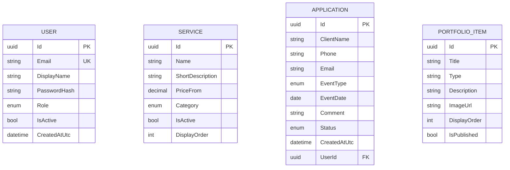

# Data Dictionary и логическая ER-модель

Физическая база проекта — MySQL.

| Сущность | Поля и ограничения |
|---|---|
| User | `Id` UUID PK; `Email` varchar(254), unique и lower-case; `DisplayName` varchar(120); `PasswordHash` varchar(300), PBKDF2-SHA256; `Role` varchar(32); `IsActive`; `CreatedAtUtc`. |
| Service | `Id` UUID PK; `Name` varchar(120); `ShortDescription` varchar(500); `PriceFrom` decimal(12,2); `Category`; `IsActive`; `DisplayOrder`. |
| PortfolioItem | `Id` UUID PK; `Title` varchar(160); `Type` varchar(120); `Description` varchar(2000); `ImageUrl` nullable; `DisplayOrder`; `IsPublished`. |
| EventType | `Id` UUID PK; `Code` varchar(32), unique; `Name` varchar(120); `IsActive`. Коды: celebration, theatre, festival, birthday, wedding, corporate, other. |
| Application | `Id` UUID PK; `ClientName` varchar(100); `Phone` varchar(30); `Email` varchar(254); `EventType`; `EventDate`; `Comment` nullable varchar(2000); `Status`; `CreatedAtUtc`; `UserId` nullable UUID для авторизованной заявки. |

Связь Client с заявками выполняется по `UserId` из JWT; для авторизованного запроса сервер также игнорирует переданный email и использует email claim. Анонимная заявка имеет `UserId = null`. Старый столбец `GuestCount` сохранён в физической таблице для обратной совместимости и записывается как `0`; в публичном контракте и расчёте он не используется.
