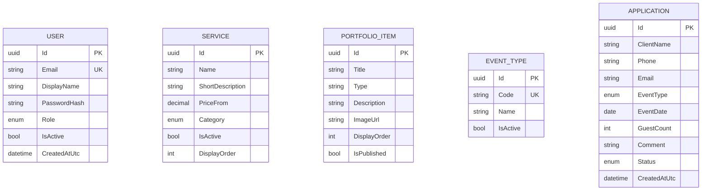

# Data Dictionary и логическая ER-модель

Текущая физическая БД проекта — MySQL. Это не миграция на PostgreSQL.

| Сущность | Поля и ограничения |
|---|---|
| User | `Id` UUID PK; `Email` varchar(254), unique, lower-case; `DisplayName` varchar(120); `PasswordHash` varchar(300), PBKDF2-SHA256; `Role` varchar(32); `IsActive` bool; `CreatedAtUtc` datetime UTC. |
| Service | `Id` UUID PK; `Name` varchar(120); `ShortDescription` varchar(500); `PriceFrom` decimal(12,2), неотрицательное; `Category` enum; `IsActive` bool; `DisplayOrder` int. |
| PortfolioItem | `Id` UUID PK; `Title` varchar(160); `Type` varchar(120); `Description` varchar(2000); `ImageUrl` nullable varchar(500); `DisplayOrder` int; `IsPublished` bool. |
| EventType | `Id` UUID PK; `Code` varchar(32), unique; `Name` varchar(120); `IsActive` bool. Справочные коды: celebration, theatre, birthday, wedding, corporate, other. |
| Application | `Id` UUID PK; `ClientName` varchar(100); `Phone` varchar(30); `Email` varchar(254); `EventType` текущий enum категории; `EventDate` date (сегодня или позже); `GuestCount` int (1–5000); `Comment` nullable varchar(2000); `Status` enum; `CreatedAtUtc` datetime UTC. |

Пока между таблицами нет FK: заявка хранит формат как enum, а не `EventType.Id`; пользовательские действия не связываются с журналом аудита. Это отражает текущую реализацию, не предполагает ещё не внедрённых связей.
